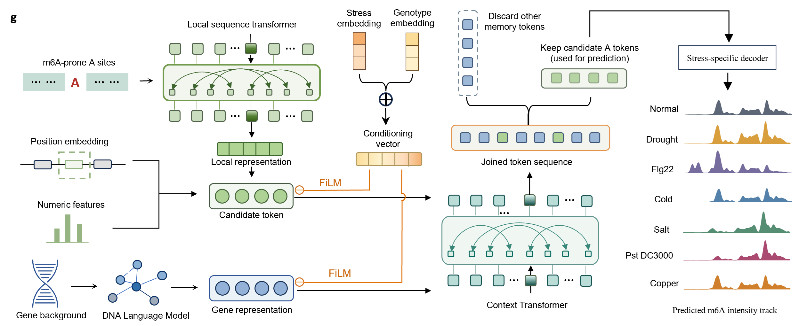

# m6A-GEM

**Genetic–Environment Model of quantitative m6A landscapes.**

m6A-GEM models m6A-associated signals in *Arabidopsis thaliana* using two components: a sequence-based candidate-site model and a quantitative model integrating local sequence, AgroNT gene embeddings, genotype and stress information.



## Quick start

Use Python 3.10 and PyTorch 2.6. Authenticate with `gh auth login`, then run:

```bash
gh repo clone ppksjjtu/m6A-GEM
cd m6A-GEM
python -m pip install -r requirements.txt
gh release download v0.1.0-models --repo ppksjjtu/m6A-GEM --dir weights --pattern '*.pt'
python examples/run_demo.py --model all --verify
```

Predictions are saved to `outputs/demo/candidate_predictions.csv` and `outputs/demo/quantitative_predictions.csv`. The `--verify` option compares them with the supplied reference outputs. Run either model individually with `--model candidate` or `--model quantitative`.

## Repository structure

| Directory | Contents |
|---|---|
| `candidate_site/` | Candidate-site model and training code |
| `quantitative/` | Context-aware quantitative model and training code |
| `configs/` | Architecture, training settings and condition vocabulary |
| `examples/` | Example inputs, inference code and reference outputs |
| `weights/` | Pretrained model manifest and download instructions |

## Inputs and outputs

The candidate-site example uses a sequence window from `AT5G01010` and outputs adenosine probabilities. `sequence_offset0` is the zero-based position within the supplied sequence.

The quantitative example uses all ten candidates from `AT5G06190`, including their 401-nt sequence windows, site features and a 1,500-dimensional AgroNT gene embedding, to predict the Col-0 / unstressed context. Input definitions are in [`examples/data/README.json`](examples/data/README.json).

The quantitative output includes presence probability, positive intensity and expected intensity:

```text
positive_intensity = expm1(softplus(intensity_logit))
expected_intensity = presence_probability * positive_intensity
```

Predicted intensity is expressed as non-negative IP-minus-background excess CPM.

## Training

Install the training dependencies and view the available arguments:

```bash
python -m pip install -r requirements-training.txt
python candidate_site/29_train_atlas_rmbase_sac_support1_metaformer.py --help
python quantitative/stage1_copper_normal_singlehead_tailbalanced_v1.py --help
```

## Pretrained models

The candidate-site model uses the Epoch 8 checkpoint and the quantitative model uses Epoch 16. Download both from [Releases](https://github.com/ppksjjtu/m6A-GEM/releases/tag/v0.1.0-models). The demo checks their SHA-256 hashes against [`weights/pretrained_models.json`](weights/pretrained_models.json).
